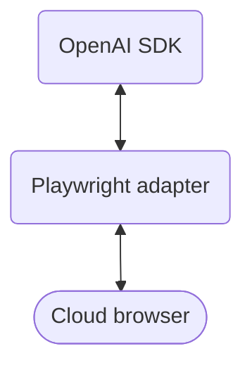

Use your existing Playwright code with a remote Browser Use Cloud browser.
OpenAI runs the model loop. A small adapter exposes Playwright actions as tools.



This example exposes `read_page`, `click`, `type`, and `select_option`.
OpenAI shared the small adapter used here; it is not a general Playwright driver.
Playwright methods become model tools only when the adapter implements them.

For all 28 browser tools and Bash, use the [Browser Use library driver](/open-source/customize/integrations/openai).

## Connect your remote browser

Replace local browser startup with these lines:

```python
session = await cloud.browsers.create(timeout=5)
browser = await playwright.chromium.connect_over_cdp(session.cdp_url)
page = await browser.contexts[0].new_page()
```

Chrome DevTools Protocol (CDP) connects Playwright to your remote Chromium browser.
Your application runs Playwright and the OpenAI SDK.
Browser Use Cloud hosts the browser.

## Run the example

You need [uv](https://docs.astral.sh/uv/getting-started/installation/) and API keys for Browser Use and OpenAI.
You need no local Chromium installation or open-source Browser Use library.

```bash
mkdir openai-playwright
cd openai-playwright
uv init --bare --python 3.12
uv add openai==3.31.0 browser-use-sdk==3.11.3 playwright==1.63.0

export BROWSER_USE_API_KEY="your-browser-use-key"
export OPENAI_API_KEY="your-openai-key"
export OPENAI_MODEL="your-model"

curl -fsSL https://raw.githubusercontent.com/browser-use/sdk/e4048eafa0dc61d8afc112a2d2d09f97022e1677/examples/openai/playwright_browser.py -o playwright_browser.py
curl -fsSL https://raw.githubusercontent.com/browser-use/sdk/e4048eafa0dc61d8afc112a2d2d09f97022e1677/examples/openai/playwright_cloud.py -o playwright_cloud.py
uv run python playwright_cloud.py
```

Get your [Browser Use key](https://cloud.browser-use.com/new-api-key) and [OpenAI key](https://platform.openai.com/api-keys).
Choose an OpenAI model that supports Responses function tools.

The model reads example.com, clicks its link, and summarizes the destination.
The script stops the Cloud browser when the task ends.

## Complete example

```python playwright_cloud.py
"""Run OpenAI browser actions through Playwright and Browser Use Cloud."""

import asyncio
import os

from browser_use_sdk.v4 import AsyncBrowserUse
from openai import AsyncOpenAI
from openai.lib.browser import AsyncBrowserToolset
from openai.lib.responses_tool_runner import AsyncResponsesToolRunner
from playwright.async_api import async_playwright

from playwright_browser import PlaywrightBrowser


async def confirm(context):
    return True


async def main() -> None:
    async with (
        AsyncBrowserUse() as cloud,
        AsyncOpenAI(timeout=180, max_retries=5) as client,
        async_playwright() as playwright,
    ):
        session = await cloud.browsers.create(timeout=5)
        browser = None
        try:
            if not session.cdp_url:
                raise RuntimeError("Browser Use did not return a CDP URL.")
            browser = await playwright.chromium.connect_over_cdp(session.cdp_url)
            page = await browser.contexts[0].new_page()
            await page.goto("https://example.com", wait_until="domcontentloaded")
            driver = PlaywrightBrowser(page)
            tools = AsyncBrowserToolset(
                driver, members=["read_page", "click", "type", "select_option"], confirm=confirm
            )
            runner = AsyncResponsesToolRunner(browser=tools)
            try:
                response = await runner.run(
                    client,
                    {
                        "model": os.environ["OPENAI_MODEL"],
                        "input": "Read the page, click Learn more, and summarize the destination.",
                        "store": False,
                    },
                    max_steps=10,
                )
                print(response.output_text)
            finally:
                runner.close()
                tools.close()
                await driver.aclose()
        finally:
            try:
                if browser is not None:
                    await browser.close()
            finally:
                await cloud.browsers.stop(session.id)


if __name__ == "__main__":
    asyncio.run(main())
```

The adapter keeps element references from each page read.
Read again after navigation or when an element reference becomes stale.
This small example supports one page and a limited set of visible form controls.

The confirmation callback approves actions for this example.
Use tasks you authorize, and change the callback for your application's permissions.

## Choose your integration

| Your application | Integration |
| --- | --- |
| Needs all browser tools, JavaScript, coordinate actions, file tools, and Bash | [Browser Use driver](/open-source/customize/integrations/openai) |
| Already uses Playwright and needs a small adapter | This example |

Both integrations use Browser Use Cloud infrastructure.
The adapter determines which actions the model can call.
